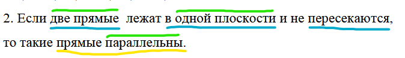
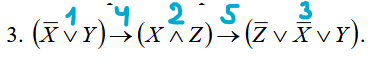
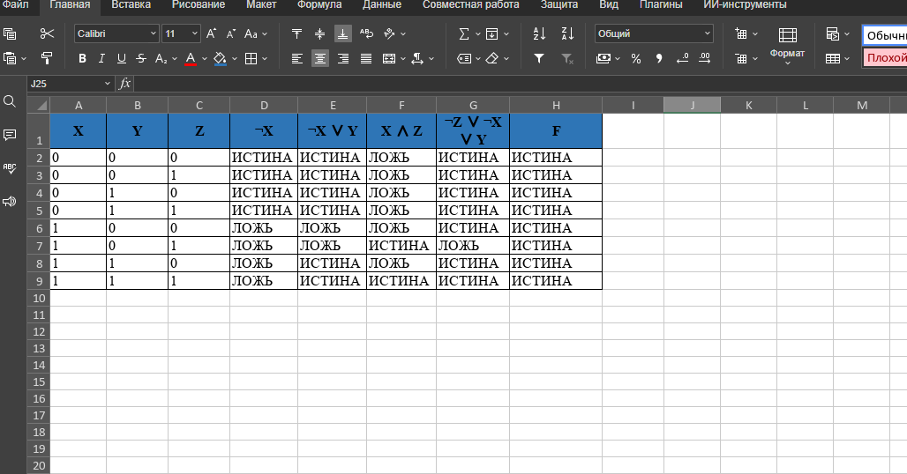

# Вариант 15: решения задач

## Задача 1
**Дано:** $(X > 1) \wedge \overline{(X < 5)} \vee (X < 3)$, $X = 2$.  
**Решение:**  
- $X > 1 \Rightarrow 2 > 1 \Rightarrow \text{истина}$;  
- $X < 5 \Rightarrow 2 < 5 \Rightarrow \text{истина} \Rightarrow \overline{\text{истина}} = \text{ложь}$;  
- $X < 3 \Rightarrow 2 < 3 \Rightarrow \text{истина}$;  
- $\text{истина} \wedge \text{ложь} \vee \text{истина} = \text{ложь} \vee \text{истина} = \text{истина}$.  
**Ответ:** $1$.

---

## Задача 2

A = две прямые в одной плоскости параллельны \
B = две прямые в одной пересекаются \
C = прямые параллельны

---

## Задача 3
**Дано:**

